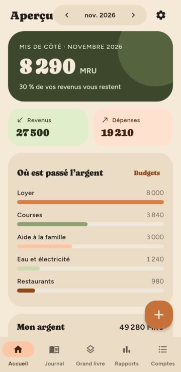
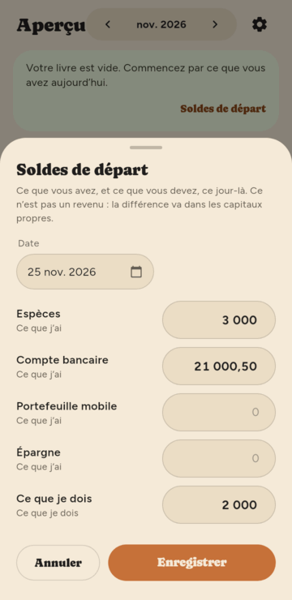

# Ledger MRU — Flutter

[](https://github.com/XERELE-MDK/ledger-mru-flutter/actions/workflows/ci.yml)

Comptabilité personnelle en ouguiya (MRU) : une vraie **partie double**, cachée derrière un mode Simple.
Ce dépôt contient le **code Dart** (écrans, logique, tests) et la **version Linux**.

| Dépôt | Contenu | Pour |
|---|---|---|
| [ledger-mru-rust](https://github.com/XERELE-MDK/ledger-mru-rust) | Rust + Slint | PC Linux, léger (~25 Mio de mémoire) |
| [ledger-mru-flutter](https://github.com/XERELE-MDK/ledger-mru-flutter) | Dart : écrans, logique, tests, version Linux | PC Linux, même app que le téléphone |
| [ledger-mru-mobile](https://github.com/XERELE-MDK/ledger-mru-mobile) | projet Android | téléphone |

Les trois lisent et écrivent **le même fichier JSON** et se synchronisent par un dossier partagé, sans serveur.

<p>
  
  
  
  
</p>

## Fonctionnalités

Chaque fonctionnalité a son dossier dans [**docs/**](docs/README.md) : ce qu'elle fait, et comment elle est codée.

[Saisie](docs/saisie/FUNCTIONALITY.md) · [Journal](docs/journal/FUNCTIONALITY.md) · [Grand livre](docs/grand-livre/FUNCTIONALITY.md) · [Rapports](docs/rapports/FUNCTIONALITY.md) · [Comptes et budgets](docs/comptes-et-budgets/FUNCTIONALITY.md) · [Soldes de départ](docs/soldes-de-depart/FUNCTIONALITY.md) · [Livre vide](docs/livre-vide-et-demo/FUNCTIONALITY.md) · [Accueils](docs/accueils/FUNCTIONALITY.md) · [Thèmes](docs/themes/FUNCTIONALITY.md) · [Langues](docs/langues/FUNCTIONALITY.md) · [Import / export](docs/import-export/FUNCTIONALITY.md) · [Synchronisation](docs/synchronisation/FUNCTIONALITY.md) · [Protection des données](docs/protection-des-donnees/FUNCTIONALITY.md) · [Paquets Linux](docs/paquets-linux/FUNCTIONALITY.md)

Versions : [journal](CHANGELOG.md) · [comment elles sont gérées](docs/VERSIONING.md).

## Démarrer

Flutter **3.44.4** (stable).

```bash
git clone https://github.com/XERELE-MDK/ledger-mru-flutter.git
cd ledger-mru-flutter
flutter pub get
flutter test
flutter run -d linux
```

Paquets prêts à installer : [Releases](https://github.com/XERELE-MDK/ledger-mru-flutter/releases).

## Licence

[GPL-3.0](LICENSE). Polices : SIL OFL 1.1, voir [assets/fonts/LICENSES.md](assets/fonts/LICENSES.md).
