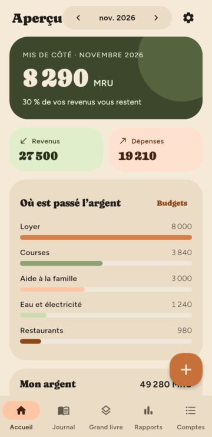
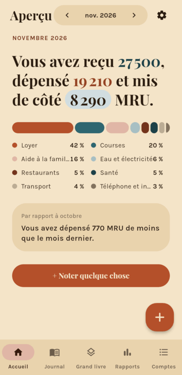
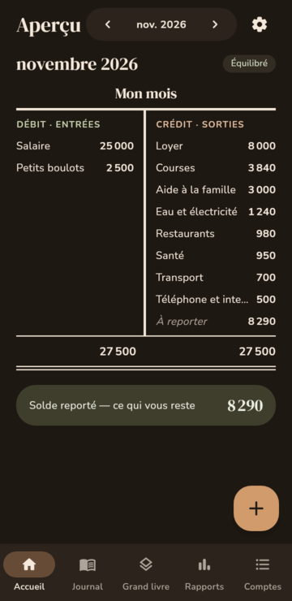
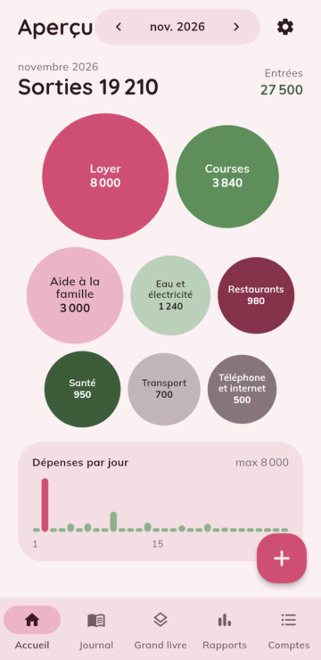

# Home screens — how it works

[← All features](../README.md) · [Code walkthrough](CODE_WALKTHROUGH.md)

Settings → Home screen:

| Home | Idea |
|---|---|
| **Overview** | cards, categories, holdings, latest entries |
| **Editorial** | the month in one sentence, stacked bar of categories |
| **T-account** | the month as a debit / credit page, the difference carried over to balance |
| **Pebbles** | spending as circles, day-by-day rhythm |

  
  
  
  

The choice is per device.
